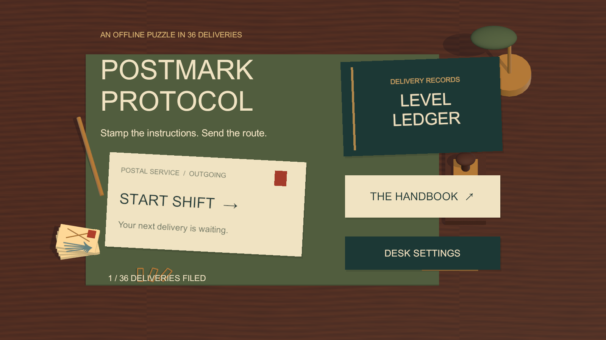
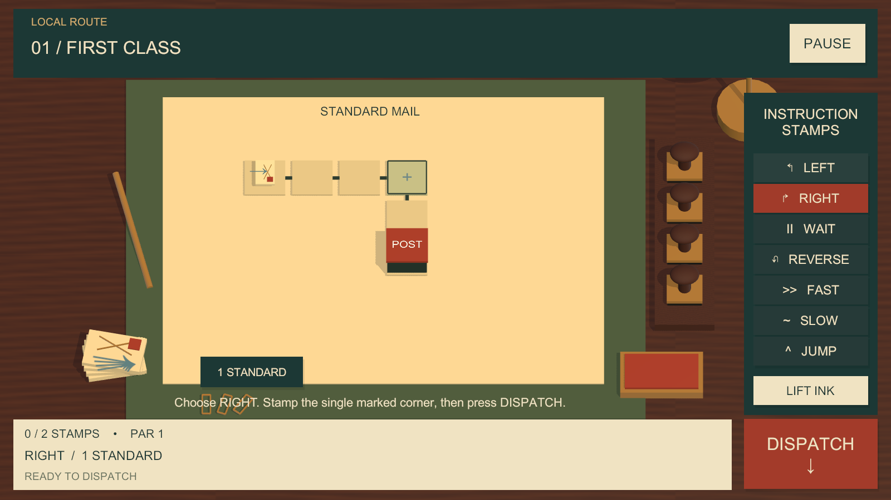

# Postmark Protocol

**Stamp the instructions. Send the route.**

A tactile, completely offline 2.5D programming puzzle for iPhone and iPad. You don't steer the envelope — you program its route with physical instruction stamps, then press **Dispatch** and watch it play out exactly as written.

## The loop

**Inspect** the route → **Stamp** your commands onto marked slots → **Dispatch** → **Observe** the delivery → **Correct** if it returns → **Deliver**.

| | |
|---|---|
| Commands | Turn Left, Turn Right, Wait, Reverse, Fast, Slow, Jump |
| Ink | Standard (once), Double (twice), Permanent (locked for the route) |
| Parcels | Standard, Fragile (no bumps), Express (no Wait), Registered (must hit every checkpoint) |
| Progression | 6 chapters × 6 levels = 36 handcrafted deliveries, each teaching one new idea |
| Rewards | Postal seals — Delivered / Efficient / Perfect Route — not stars |

## Tech

- Unity **6000.3.19f1**, built-in render pipeline
- Namespace `RehmanMughal.PostmarkProtocol`, assembly `PostmarkProtocol.Runtime`
- Deterministic, frame-rate-independent `RouteSimulator` — no physics, no coroutine-based gameplay logic
- Fully **authored** scene hierarchy (`Bootstrap` → `MainDesk` → `Gameplay`); no runtime construction of primary UI
- Local versioned save with checksum, atomic write, backup and migration — no accounts, no cloud
- Real Master/Music/SFX/UI audio mixer; original SFX and music; native iOS haptics bridge
- **Zero** network calls, analytics, ads, or tracking in the shipped runtime (verified against the actual exported iOS build, not just source)

## Status

- Automated tests: 66/66 EditMode
- Automated Play Mode integration QA: 36/36 levels through the real authored UI, 0 layout findings
- iOS dev + release Xcode exports: succeed, 0 errors/0 warnings, icon catalog and `Info.plist` verified
- Remaining gate: a signed archive and physical-device QA require macOS/Xcode and an Apple signing identity — genuinely external to this environment, not unfinished work

See [`Documentation/FINAL_AUDIT.md`](Documentation/FINAL_AUDIT.md) for the full PASS/FAIL/EXTERNAL breakdown.

## Documentation

| Doc | Covers |
|---|---|
| [`PRODUCTION_BRIEF.md`](Documentation/PRODUCTION_BRIEF.md) | Original production spec |
| [`ARCHITECTURE.md`](Documentation/ARCHITECTURE.md) | Systems, dependency direction, scene/save/audio architecture |
| [`GAME_DESIGN.md`](Documentation/GAME_DESIGN.md) | Implemented mechanics and rules |
| [`LEVEL_DESIGN.md`](Documentation/LEVEL_DESIGN.md) | All 36 levels: objective, stamps, par, solution |
| [`UI_UX_SYSTEM.md`](Documentation/UI_UX_SYSTEM.md) | Visual language, color/spacing/typography tokens, animation |
| [`QA_REPORT.md`](Documentation/QA_REPORT.md) / [`UI_QA_REPORT.md`](Documentation/UI_QA_REPORT.md) | Test and integration QA evidence |
| [`FINAL_AUDIT.md`](Documentation/FINAL_AUDIT.md) | Completion gate, category by category |
| [`IOS_RELEASE_CHECKLIST.md`](Documentation/IOS_RELEASE_CHECKLIST.md) | Bundle ID, build config, export evidence |
| [`NETWORK_AUDIT.md`](Documentation/NETWORK_AUDIT.md) / [`PACKAGE_AUDIT.md`](Documentation/PACKAGE_AUDIT.md) | Offline/dependency verification |
| [`ART_LICENSES.md`](Documentation/ART_LICENSES.md) / [`AUDIO_LICENSES.md`](Documentation/AUDIO_LICENSES.md) | Provenance for every shipped asset |
| [`APP_STORE_METADATA.md`](Documentation/APP_STORE_METADATA.md) | App Store listing draft |

Development rules for any agent or contributor working on this project are in [`AI_RULES.md`](AI_RULES.md); persistent project memory is in [`MEMORY_BANK.md`](MEMORY_BANK.md).

## Identity

Bundle ID `com.rehmanmughal.postmarkprotocol` · Version 1.0.0 · IL2CPP / ARM64 / Metal · iOS 15+ · Landscape only (iPhone + iPad)
